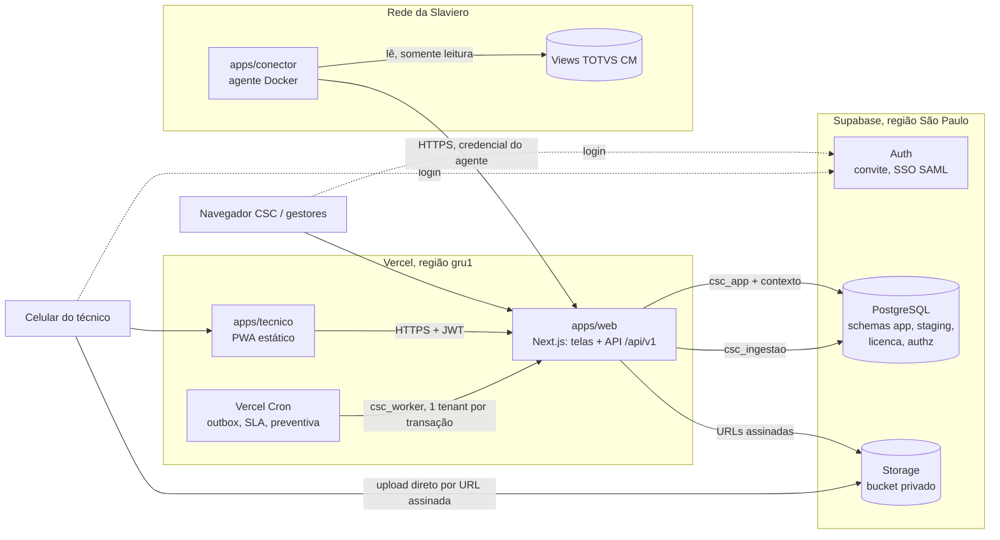

# 01 — Arquitetura

Monólito modular multi-tenant sobre Supabase (PostgreSQL, Auth, Storage) e Vercel. O código de negócio fica em pacotes TypeScript independentes de framework, para que o módulo possa ser extraído ou mudar de hospedagem sem reescrita.

## Visão geral

## Componentes

**apps/web (Next.js na Vercel).** Serve as telas do CSC, gestores e administração, e expõe a API `/api/v1`, usada também pelo PWA e pelo agente. Os handlers são finos: validam a entrada com Zod, montam o `Contexto` e chamam um caso de uso de `packages/aplicacao`. Server Components podem chamar casos de uso diretamente, sempre com `Contexto`.

**apps/tecnico (PWA).** App React + Vite com service worker, IndexedDB e fila de sincronização. Fala só com a API `/api/v1`, com o access token do Supabase no cabeçalho. Cada operação offline leva uma chave de idempotência gerada no aparelho, e a API ignora repetições.

**apps/conector (agente local).** Container Node rodando dentro da rede do cliente. Lê as views acordadas do TOTVS com usuário somente leitura e envia lotes por HTTPS para `/api/v1/ingestao/lotes`. Ele não tem nenhuma credencial do banco da CSC, só uma credencial de agente revogável por tenant. Não precisa de VPN: a conexão sai do cliente em HTTPS. O contrato de dados é o de `packages/contratos` (adaptador de sistema hoteleiro); o TOTVS é o primeiro adaptador.

**Supabase.** PostgreSQL com os schemas da CSC fora da Data API; Auth para convite por e-mail e, se a Slaviero tiver, SSO SAML (Entra ID); Storage com bucket privado, acessado só por URLs assinadas emitidas pela API depois da checagem de escopo.

**Vercel Cron.** Aciona rotas protegidas por `CRON_SECRET`. Cada rota abre conexão com `csc_worker`, lista os tenants e processa um tenant por transação.

## Fluxos

### Requisição de usuário

1. O middleware valida a sessão do Supabase Auth (cookie no web, Bearer no PWA) e extrai `sub`, o id do usuário.
2. A API lê o tenant ativo (cookie ou cabeçalho `x-csc-tenant`). Ele não precisa ser confiável: o banco só aceita tenants dos quais o usuário é membro ativo.
3. `withContext({ usuarioId, tenantId }, fn)` abre uma transação no pool `csc_app` (Supavisor, modo transação), executa `set_config('app.usuario_id', …, true)` e `set_config('app.tenant_id', …, true)` e roda `fn`.
4. O caso de uso aplica as regras de negócio e a permissão de ação. As policies garantem o escopo.
5. Escritas passam pela unit of work: mudança, auditoria e evento de domínio na mesma transação.

### Ingestão do TOTVS

1. O agente monta um lote (entidade, registros, hash do lote) e envia com `Authorization: Agent csc_<tenant_id>_<segredo>`.
2. A API extrai o `tenant_id` do prefixo e abre transação com `csc_ingestao` e `app.tenant_id`. Depois busca a credencial (a RLS limita ao tenant) e compara o hash do segredo.
3. Se o lote já foi recebido (`staging.carga` com o mesmo `lote_hash`), a API responde 200 e não reprocessa.
4. Grava os registros em `staging.registro_externo` com upsert por chave e hash.
5. Um job (`csc_worker`) promove UHs para `app.local`, aplicando a regra de licença na aplicação.

O limite de 4,5 MB de corpo das funções da Vercel define o tamanho máximo do lote; o agente divide em lotes menores.

### Outbox e notificações

1. O caso de uso grava o evento em `app.evento_dominio` na mesma transação da mudança.
2. O cron do outbox (a cada minuto) seleciona eventos pendentes do tenant com `for update skip locked`, chama os handlers (e-mail, push, futuramente WhatsApp e EasyTools) e marca `processado_em`.
3. Em falha, incrementa `tentativas`, registra `erro` e empurra `disponivel_em` com backoff. Os handlers são idempotentes pelo id do evento.

### Upload de fotos e anexos

1. O PWA pede à API uma URL de upload para uma entidade (ex.: OS).
2. A API checa o escopo dentro de `withContext` e gera a URL assinada de upload no caminho `{tenant_id}/{hotel_id}/{entidade}/{registro_id}/{uuid}`.
3. O aparelho comprime a foto e envia direto para o Storage, sem passar pela função da Vercel.
4. A API registra o anexo. Downloads usam URLs assinadas de curta duração.

## Papéis de banco

| Papel | Quem usa | Pode |
|---|---|---|
| `csc_app` | API e telas | Dados de negócio no escopo do usuário da sessão |
| `csc_worker` | Rotas de cron | Dados de um tenant por transação, sem usuário |
| `csc_ingestao` | Endpoint de ingestão | Só `staging`, do tenant da credencial |
| `csc_backoffice` | Backoffice EasyGov | Só `licenca.contrato` e `licenca.uso()` |
| `csc_authz` | Dono das funções de autorização | Leitura das tabelas de escopo; sem LOGIN |
| `postgres` | Migrações e operação | Nunca usado pela aplicação em execução |

## Ambientes

| Ambiente | Supabase | Vercel |
|---|---|---|
| Local | `supabase start` | `pnpm dev` |
| Staging | Projeto próprio, região São Paulo | Previews e branch `staging` |
| Produção | Projeto próprio, região São Paulo, PITR | Branch `main` |

Previews nunca apontam para produção. Migrações vão para staging automaticamente e para produção com aprovação manual na CI.

## LGPD e operação

- Dados em repouso no Supabase, região São Paulo; funções da Vercel fixadas em `gru1`.
- Quem tem acesso ao painel ou ao SQL Editor do Supabase de produção enxerga tudo, sem RLS. O acesso fica restrito a poucas pessoas, com MFA obrigatório. Toda consulta manual em produção é registrada em um log de operação.
- Pessoas da EasyGov acessam dados operacionais de um cliente só como membros convidados por ele, com papel e auditoria.
