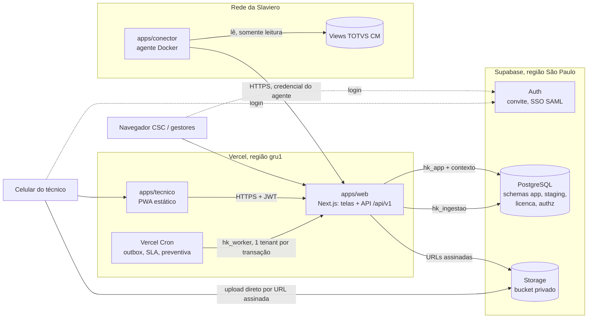

# 01 — Arquitetura

Monólito modular multi-tenant sobre Supabase (PostgreSQL, Auth, Storage) e Vercel. O código de negócio fica em pacotes TypeScript independentes de framework, para que o módulo possa ser extraído ou mudar de hospedagem sem reescrita.

## Visão geral

## Componentes

**apps/web (Next.js na Vercel).** Serve as telas do CSC, gestores e administração, e expõe a API `/api/v1`, usada também pelo PWA e pelo agente. Os handlers são finos: validam a entrada com Zod, montam o `Contexto` e chamam um caso de uso de `packages/aplicacao`. Server Components podem chamar casos de uso diretamente, sempre com `Contexto`.

**apps/tecnico (PWA).** App React + Vite com service worker, IndexedDB e fila de sincronização. Fala só com a API `/api/v1`, com o access token do Supabase no cabeçalho. Cada operação offline leva uma chave de idempotência gerada no aparelho, e a API ignora repetições: a chave é gravada em `app.operacao_offline` na mesma unit of work do efeito (ADR-025, fluxo em "Sincronização offline do PWA").

**apps/conector (agente local).** Container Node rodando dentro da rede do cliente. Lê as views acordadas do TOTVS com usuário somente leitura e envia lotes por HTTPS para `/api/v1/ingestao/lotes`. Ele não tem nenhuma credencial do banco do HubKeep, só uma credencial de agente revogável por tenant. Não precisa de VPN: a conexão sai do cliente em HTTPS. O contrato de dados é o de `packages/contratos` (adaptador de sistema hoteleiro); o TOTVS é o primeiro adaptador.

**Supabase.** PostgreSQL com os schemas do HubKeep fora da Data API; Auth para convite por e-mail e, se a Slaviero tiver, SSO SAML (Entra ID); Storage com bucket privado, acessado só por URLs assinadas emitidas pela API depois da checagem de escopo.

**Vercel Cron.** Aciona rotas protegidas por `CRON_SECRET`. Cada rota abre conexão com `hk_worker`, lista os tenants e processa um tenant por transação.

## Fluxos

### Requisição de usuário

1. O middleware valida a sessão do Supabase Auth (cookie no web, Bearer no PWA) e extrai `sub`, o id do usuário.
2. A API lê o tenant ativo (cookie ou cabeçalho `x-hubkeep-tenant`). Ele não precisa ser confiável: o banco só aceita tenants dos quais o usuário é membro ativo.
3. `withContext({ usuarioId, tenantId }, fn)` abre uma transação no pool `hk_app` (Supavisor, modo transação), executa `set_config('app.usuario_id', …, true)` e `set_config('app.tenant_id', …, true)` e roda `fn`.
4. O caso de uso aplica as regras de negócio e a permissão de ação. As policies garantem o escopo.
5. Escritas passam pela unit of work: mudança, auditoria e evento de domínio na mesma transação.

### Contrato da API `/api/v1` (F0-07)

- **Contratos:** entrada e saída de cada rota são schemas Zod em `packages/contratos`. O handler valida o corpo antes do caso de uso e a resposta antes de enviar; resposta fora do contrato é defeito (500). O OpenAPI 3.1 é gerado desses schemas e servido em `/api/interno/openapi`, que exige sessão válida.
- **Formato único de erro:** `{ "erro": { "codigo", "parametros", "requestId" } }`, nunca frase (ADR-022). Quem exibe traduz pelo catálogo. A frase dos erros de domínio fica só no log.

| Origem | Status | Código |
|---|---|---|
| Regra do domínio | 403, 404, 409 ou 422, pela classe do erro | o do domínio |
| Entrada fora do contrato | 422 | `entrada_invalida`, com `parametros.problemas` por campo (sem o valor recebido) |
| Sem sessão ou token inválido | 401 | `nao_autenticado` |
| Tenant não informado | 400 | `tenant_ausente` |
| RLS recusou (42501) | 403 | `sem_permissao` |
| Integridade recusou (23503/23514) | 422 | `recusado_pela_integridade` |
| Qualquer outra coisa | 500 | `erro_interno`, sem detalhe |

- **`request_id`:** o `x-request-id` recebido, se for UUID, ou um novo. Volta no cabeçalho da resposta, no corpo do erro e no log.
- **Log estruturado:** uma linha JSON por requisição, com `rota`, `metodo`, `status`, `duracao_ms`, `request_id`, `tenant_id` e `usuario_id`. Erro inesperado gera também uma linha `erro_inesperado`. Corpo, token, cookie e senha nunca entram.
- **Sentry:** só erro inesperado, com as marcas de escopo (ids). A coleta de dados do SDK fica desligada por categoria: usuário, cookies, cabeçalhos, corpos, query, dados de consulta e variáveis locais. Sem `SENTRY_DSN`, nada é enviado.

### Ingestão do TOTVS (F0-08)

1. O agente monta um lote (`fonte`, `entidade`, `registros` com `chave` e `dados`, contrato `LoteDeIngestao`) e envia para `POST /api/v1/ingestao/lotes` com `Authorization: Agent hk_<tenant_id>_<segredo>`. Os lotes são divididos antes, para caber no limite de 2.000 registros e 4 MB.
2. A API extrai o `tenant_id` do prefixo e abre uma transação com `hk_ingestao` e `app.tenant_id`. Lê as credenciais (a RLS só mostra as não revogadas do tenant) e compara o hash do segredo em tempo constante. Credencial que não confere recebe 401.
3. O hash do lote é **calculado pelo servidor** sobre o conteúdo canônico (registros em ordem de chave, dados com as chaves ordenadas). Lote igual tem hash igual: a API responde 200 com `novo: false` e não reprocessa. Lote novo recebe 201.
4. Os registros entram em `staging.registro_externo` com upsert por chave. Um registro só é regravado quando o hash do conteúdo muda. O staging não passa pela unit of work (`hk_ingestao` nem enxerga `app`); o registro do lote é a própria `staging.carga`.
5. A promoção de UHs para `app.local` roda no `hk_worker`, uma unit of work por tenant, com auditoria e evento `local.promovido`. A regra de licença é da aplicação (`statusDaUhNova` no domínio): a UH nova só entra ativa em hotel ativo e com saldo; senão, entra `pendente_licenca`. Hotel em implantação não consome licença. A contagem de uso é a mesma de `licenca.uso()`, com teste de paridade na CI. A rota de cron que chama a promoção para todos os tenants é da F0-09.
6. A credencial é criada e revogada pelo Admin do grupo (`/api/v1/credenciais-agente`). O segredo aparece só na resposta da criação; o banco guarda `sha256:` do segredo.

O limite de 4,5 MB de corpo das funções da Vercel define o tamanho máximo do lote; o agente divide em lotes menores.

### Outbox e notificações

1. O caso de uso grava o evento em `app.evento_dominio` na mesma transação da mudança.
2. O cron do outbox (a cada minuto) seleciona eventos pendentes do tenant com `for update skip locked`, chama os handlers (e-mail, push, futuramente WhatsApp e EasyTools) e marca `processado_em`.
3. Em falha, incrementa `tentativas`, registra `erro` e empurra `disponivel_em` com backoff. Os handlers são idempotentes pelo id do evento.

### Upload de fotos e anexos (F0-10, ADR-024)

1. O PWA pede à API uma URL de upload (`POST /api/v1/anexos/url-de-upload`) para um registro (`entidade`, `registroId`) e um tipo de arquivo.
2. A API confere o escopo dentro de `withContext`, pela RLS e pelas funções `authz.*`:
   - o registro precisa ser visível ao usuário;
   - o hotel dele precisa estar entre os que o usuário escreve.

   Depois calcula o caminho `{tenant_id}/{hotel_id}/{entidade}/{registro_id}/{uuid}.{ext}` e pede ao `auth-admin` a URL assinada.
3. O aparelho comprime a foto e envia direto para o Storage (PUT na URL), sem passar pela função da Vercel. A miniatura é gerada no aparelho e vai como um segundo objeto (ADR-024).
4. O download usa URL assinada de 5 minutos (`/api/v1/anexos/url-de-download`). A API confere de novo:
   - o tenant do caminho;
   - que o hotel está entre os que o usuário lê;
   - que o registro é daquele hotel.

   Fora do escopo, 404.
5. O bucket `anexos` é privado e não tem policy para `anon`, `authenticated` ou `public` (meta-teste 24): sem URL assinada, ninguém lê nem grava. O registro do anexo numa tabela de negócio entra com a OS, na fase 1a.

### Sincronização offline do PWA (F0-11, ADR-025)

1. O técnico faz a operação, com ou sem rede. Ela entra na fila do IndexedDB com uma chave nova (`crypto.randomUUID()`).
2. O app manda a fila ao abrir, depois de cada operação, quando a rede volta e a cada 30 s. Vai uma por vez, na ordem em que foram feitas, para `POST /api/v1/sincronizacao/operacoes`.
3. A API valida e aplica o efeito numa unit of work. Na mesma transação grava a chave em `app.operacao_offline`, com a resposta.
4. Respostas:
   - **201:** aplicada;
   - **200 com `repetida: true`:** a chave já tinha chegado, porque a resposta se perdeu ou o envio foi duplo. Nada é aplicado de novo;
   - **422:** operação recusada. A chave não é guardada, e o aparelho a mostra como rejeitada.
5. Sem rede, com 5xx ou 401, a operação espera (5 s, dobrando até 5 min), e nenhuma operação mais nova passa na frente.

O service worker guarda só a casca do app, e os quatro catálogos vão no build. A API nunca é servida do cache.

### Idioma e região (F0-10b, ADR-022)

- **Catálogos:** `packages/i18n` guarda um JSON por idioma (pt-BR, en, es, fr) com chaves semânticas e sintaxe ICU. pt-BR é o idioma-fonte e define as chaves, que são tipadas: chave inexistente não compila. Faltando tradução, es e fr caem para en e depois para pt-BR.
- **Motor:** FormatJS. No web, `react-intl`, com o `IntlProvider` montado pelo layout. No worker (e-mail, push), `@formatjs/intl`, sem React. No PWA, `react-intl` (F0-11).
- **Resolução do idioma:** membro → hotel em foco → tenant → navegador → pt-BR.
  - `GET /api/v1/preferencias` devolve o idioma, o formato regional, o fuso e a moeda já resolvidos; `PUT` grava os do próprio usuário, em `app.preferencia_membro`, com auditoria.
  - Na tela, o layout lê o cookie `hk_idioma` (ou o `Accept-Language`) e entrega ao cliente só as mensagens daquele idioma. A tela inicial grava no cookie o idioma resolvido do membro e pede a página de novo.
- **Formatação:** data, número e moeda por `Intl`, com o formato regional (escolha separada do idioma) e o fuso de quem vê.
- **Pseudo-idioma `en-XA`:** acentos, texto ~35% mais longo e colchetes. Só com `HK_PSEUDO_IDIOMA=1` (dev e homologação).
- **E-mail de convite:** montado por `emailDeConvite` a partir do catálogo. O template do Supabase (`supabase/templates/convite.html`) é gerado dele em pt-BR, e um teste confere o arquivo e o assunto no `config.toml`.

## Papéis de banco

| Papel | Quem usa | Pode |
|---|---|---|
| `hk_app` | API e telas | Dados de negócio no escopo do usuário da sessão |
| `hk_worker` | Rotas de cron | Dados de um tenant por transação, sem usuário; publica eventos no outbox (ADR-013) |
| `hk_ingestao` | Endpoint de ingestão | Só `staging`, do tenant da credencial |
| `hk_backoffice` | Backoffice EasyGov | Só `licenca.contrato` e `licenca.uso()` |
| `hk_authz` | Dono das funções de autorização | Leitura das tabelas de escopo; sem LOGIN |
| `postgres` | Migrações e operação | Nunca usado pela aplicação em execução |

## Ambientes

| Ambiente | Supabase | Vercel |
|---|---|---|
| Dev | Projeto próprio na nuvem (`HubKeep-dev`), região São Paulo, sem dados reais (ADR-015) | `pnpm dev` na máquina, apontando para o dev |
| CI | `supabase start` no runner do GitHub Actions, descartável | — |
| Staging | Projeto próprio, região São Paulo | Previews e branch `staging` |
| Produção | Projeto próprio, região São Paulo, PITR | Branch `main` |

Previews nunca apontam para produção. Migrações vão para staging automaticamente e para produção com aprovação manual na CI.

## LGPD e operação

- Dados em repouso no Supabase, região São Paulo; funções da Vercel fixadas em `gru1`.
- Quem tem acesso ao painel ou ao SQL Editor do Supabase de produção enxerga tudo, sem RLS. O acesso fica restrito a poucas pessoas, com MFA obrigatório. Toda consulta manual em produção é registrada em um log de operação.
- Pessoas da EasyGov acessam dados operacionais de um cliente só como membros convidados por ele, com papel e auditoria.
