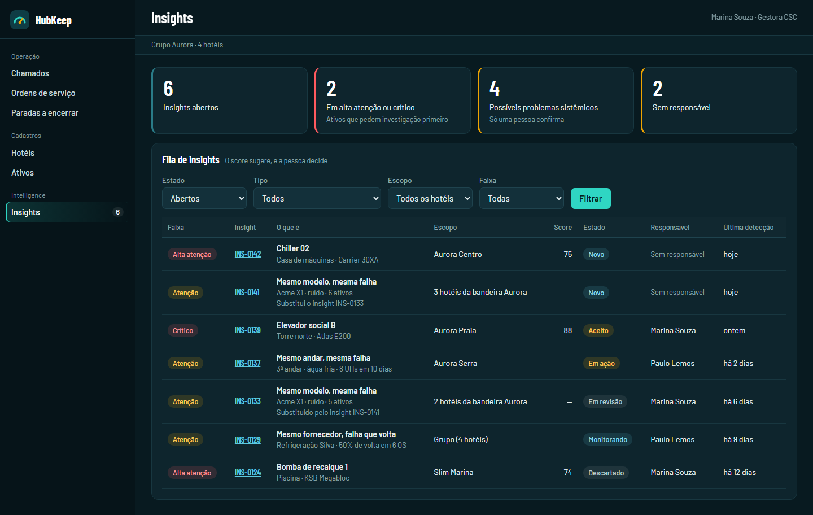
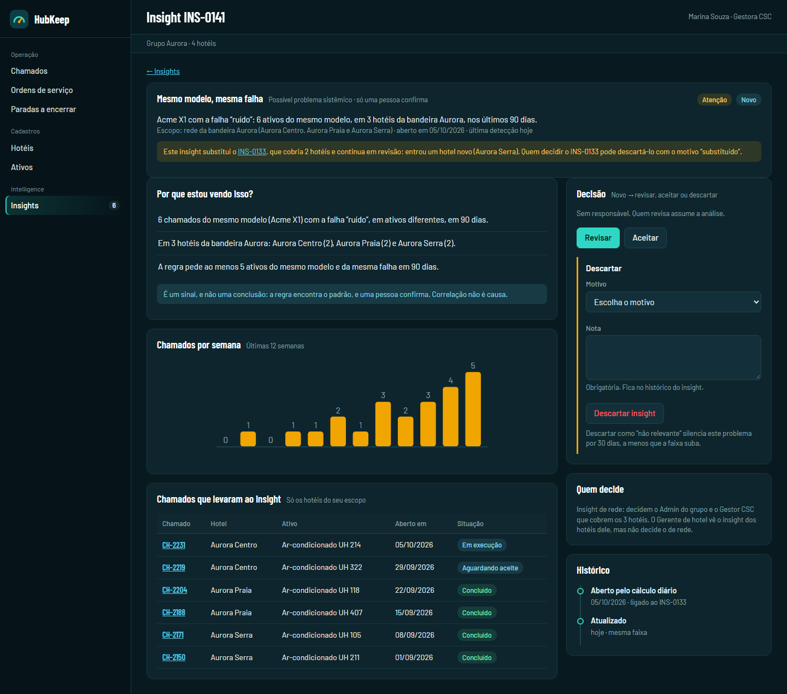
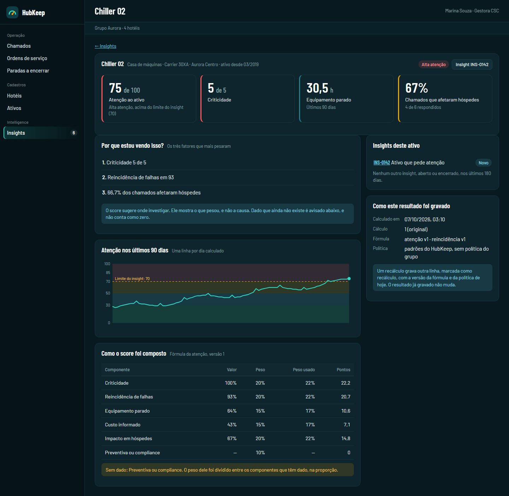

# Proposta: as telas do Intelligence 1.0

**Situação:** proposta de 07/10/2026, do agente do Kaio, **para aprovação do Cesar e do Kaio antes de virar tela real**. Nada foi implementado nas apps: as imagens saem de uma vitrine descartável (Vite, com o `packages/ui` e dados fictícios), vista nos dois temas e em largura de celular, como a U4a fez. A vitrine não entra no repositório. O código dela está guardado no branch `int-rascunhos` (`rascunhos/telas-vitrine/`), para refazer as imagens quando a proposta mudar.

**O que é de verdade nas imagens:** o menu e a estrutura vêm do `packages/ui`. Os scores, as faixas, os pesos e as frases de "Por que estou vendo isso?" saem do motor (`packages/inteligencia`) e do catálogo em pt-BR. O resto (nomes de hotéis, ativos, chamados e a série diária) é fictício.

## As três telas

### 1. Lista de insights

Também em [tema claro](design/intelligence-1-0/lista-claro.png) e [largura de celular](design/intelligence-1-0/lista-celular.png).

- **Rota:** `apps/web/src/app/(painel)/inteligencia/insights/`, em pasta `inteligencia`, como a liberação do lint exige (ADR-026, adendo). Menu novo: grupo "Intelligence", item "Insights", com a contagem dos abertos.
- **Quatro indicadores:** abertos, em alta atenção ou crítico, possíveis problemas sistêmicos e sem responsável. A cor da borda reforça, e o texto diz o mesmo.
- **Filtros:** estado (abertos por padrão), tipo, escopo e faixa.
- **Tabela:** faixa, número do insight, o que é, escopo, score, estado, responsável e última detecção. O insight sistêmico não tem score (traço) e entra na faixa Atenção. O insight de rede mostra o escopo como "3 hotéis da bandeira Aurora".
- **Substituição:** "Substitui o insight X" e "Substituído pelo insight X", calculado pelo vínculo (`substituidoPor`, no motor).
- **Quem vê:** cada pessoa vê só o insight cujos hotéis todos ela lê (RLS da `app.insight`). Sem o módulo contratado (`licenca.modulo`), o menu e as rotas não existem.

### 2. Painel de investigação (insight sistêmico)

Também em [tema claro](design/intelligence-1-0/investigacao-claro.png) e [largura de celular](design/intelligence-1-0/investigacao-celular.png).

- **Cabeçalho:** o que é, o escopo, as datas e, quando há, o aviso de substituição ("este insight substitui o INS-0133, que continua em revisão").
- **Por que estou vendo isso?** Os números que a regra encontrou e o limite dela, e o aviso de que é um sinal e não uma conclusão (PRD, princípio 7).
- **Série:** chamados por semana, nas últimas 12 semanas.
- **Chamados que levaram ao insight:** tabela com link para cada chamado, **só dos hotéis do escopo de quem lê**. O detalhamento nunca cita hotel fora desse escopo (a evidência guarda ids, e a RLS da origem filtra).
- **Decisão (coluna lateral):** as ações que o estado atual permite (de "novo": revisar, aceitar ou descartar). O descarte pede o motivo (não relevante, ou substituído por outro insight) e a nota, obrigatória. O texto avisa que "não relevante" silencia o problema por 30 dias, a menos que a faixa suba.
- **Quem decide:** o texto da regra do escopo (no insight de rede, o Admin do grupo e o Gestor CSC que cobrem todos os hotéis).
- **Histórico:** a linha do tempo do insight.

### 3. Detalhe do ativo, com "Por que estou vendo isso?"

Também em [tema claro](design/intelligence-1-0/ativo-claro.png) e [largura de celular](design/intelligence-1-0/ativo-celular.png).

- **Indicadores:** a atenção (com a faixa e o limite do insight), a criticidade, as horas paradas e o impacto em hóspedes.
- **Por que estou vendo isso?** Os três fatores que mais pesaram, em frases do catálogo (`explicacaoDoScore`). O aviso diz que o score mostra o que pesou, e não a causa.
- **Atenção nos últimos 90 dias:** uma linha por dia calculado, sobre as faixas e a linha do limite do insight.
- **Como o score foi composto:** os componentes, com valor, peso, peso usado e pontos. O componente sem dado aparece com traço, e um aviso diz que o peso dele foi dividido entre os outros (ADR-034).
- **Como este resultado foi gravado:** quando foi calculado, o número do cálculo (original ou recálculo), a versão da fórmula e a da política. É a condição do Cesar no ADR-036 aparecendo na tela.
- **Insights deste ativo,** com link.

## Como as telas se ligam

- O insight de atenção abre a **página do insight** (a mesma estrutura da tela 2, com o resumo do ativo no lugar da tabela de chamados por regra). A página do ativo é a vista do score, aberta pelo link do insight ou pelo cadastro de ativos. Na vitrine, por simplicidade, a linha de atenção da lista abre a página do ativo.
- Decidir (revisar, aceitar, agir, monitorar, resolver, descartar) só existe na página do insight. A página do ativo não decide nada.

## O que muda no `packages/ui`

Dois acréscimos pequenos, num PR do `packages/ui` (não é zona protegida):
- `hk-indicadores`: a fileira de indicadores (grade com colunas que se ajustam à largura), que cada tela hoje improvisaria;
- `hk-dados`: pares de rótulo e valor (`dl`), para o bloco "como este resultado foi gravado".

Os gráficos são SVG simples nas próprias telas, sem biblioteca, com `role="img"` e o resumo no `aria-label`. A tabela de componentes e a tabela de chamados são a alternativa em texto.

## Textos novos nos catálogos

Já existem, nos quatro idiomas: as frases dos motivos, os nomes dos scores e das faixas, os estados, ações e tipos do insight, o motivo do descarte, o "substituído pelo insight" e os erros. Faltam, e entram junto com as telas:
- o menu ("Intelligence", "Insights") e os títulos das três páginas;
- os rótulos dos filtros, dos indicadores e das colunas;
- os títulos dos painéis, os avisos ("é um sinal, e não uma conclusão", "o score mostra o que pesou, e não a causa", "o peso foi dividido") e o texto de quem decide por escopo;
- os nomes dos seis componentes da atenção e as frases das regras sistêmicas na tela de investigação (a regra e os números da evidência).

## Decisões para aprovar

1. **O desenho das três telas** como nas imagens, ou o que mudar.
2. **A ligação entre elas:** o insight de atenção abre a página do insight, e a página do ativo é a vista do score (acima).
3. **O menu do 1.0:** só "Insights". A lista "Top ativos por atenção" do PRD (seção 19) fica para uma tela à parte, depois, ou entra agora como quarta tela.
4. **O que fica fora das telas do 1.0:** abrir chamado, criar preventiva, vincular feedback e solicitar orçamento (PRD, seção 20) dependem de fase 2 ou da 1.5. O 1.0 decide o insight e mostra a evidência.
5. **Os UH-dias perdidos** não aparecem: dependem da decisão em `docs/referencia/proposta-uh-indisponivel-intelligence.md`.
6. **O gráfico de 90 dias em celular** fica pequeno. A proposta é aceitar assim no 1.0 (a tabela de componentes e os indicadores já dizem o essencial), ou dar rolagem horizontal ao gráfico.

## Ordem de trabalho depois da aprovação

As telas só viram código depois das tabelas e da ligação do job no web, que esperam a etapa I da 1b. Antes disso, só entram o PR do `packages/ui` (os dois acréscimos) e os textos novos dos catálogos, se o Cesar quiser adiantá-los.
